[`portfolio ↗`](https://samjonath.xyz) &nbsp; [`linkedin ↗`](https://www.linkedin.com/in/sam-jonath/)

### `01` about

Full-stack engineer with **3 years** of building production systems, most of them in fintech. I like owning things end to end, from the data model and backend services to the UI people use.

### `02` open source

| status | repo | contribution |
|:--|:--|:--|
| `merged` | [redis/node-redis#3616](https://github.com/redis/node-redis/pull/3616) | fix client-side cache serving stale SORT_RO, XINFO and MEMORY USAGE results |
| `merged` | [actualbudget/actual#9529](https://github.com/actualbudget/actual/pull/9529) | fix bank balances shown wrong or crashing when linking accounts |

### `03` stack

| layer | tools |
|:--|:--|
| `lang` |      |
| `front` |    |
| `back` |     |
| `data` |       |
| `infra` |      |
